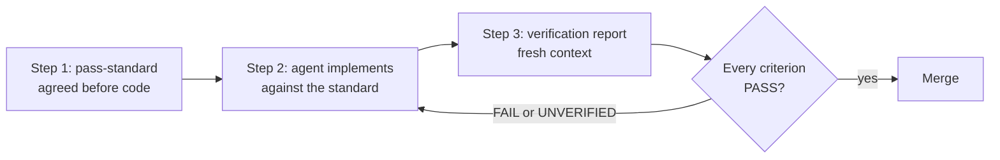

*A pass-standard written before the work, a verification report written after it, and the small amount of setup that makes both routine*

*Part 2 of 2. [Part 1](#read=trust_but_verify.md) described seven ways agent work looks finished and isn't. This part is the fix, with templates you can copy.*

---

> **A note on provenance.** The two documents described here came directly out of the failures in Part 1. Each criterion type exists because skipping it cost me something real: a hollow test, a throttled consumer, a number nobody had checked. The worked example is generic, but it is shaped like real work, and the problems it catches are the ones Part 1 describes.

---

Agent output arrives with three things attached: a diff, a passing test run, and a transcript. None of them tells you whether the change is correct. The diff shows what moved. The test run shows that whatever was asserted holds, which is only useful if the right things were asserted. The transcript is the agent's own account of its work, written by the same process that would have made any mistake in the first place. The missing piece is something that connects a definition of correct, agreed in advance, to evidence collected afterwards by someone other than the author.

## Why the agent can't sign off on its own work

The obvious shortcut is a final step where the agent reviews what it did. Keep that step, since it catches missed files and leftover debug code, but don't let it be the gate. The reviewing context holds the same beliefs as the authoring context. If the agent had known the integration test was hollow, it would not have written it that way, and asking it to review the test means asking it to doubt the reasoning that produced the test with nothing new to go on.

Research on self-correction points the same way. Huang et al. (2024) tested whether models could improve their own answers on reasoning benchmarks with no outside signal. Mostly they couldn't, and performance sometimes dropped after the "correction" because the model talked itself out of right answers. The authors also showed that earlier reports of successful self-correction had leaned on oracle labels to decide when to stop, which is external feedback by another name. The useful ingredient was never the second look. It was new information.

That gives two requirements for a review you can rely on. The reviewer runs in a fresh context that has not seen the implementation transcript, so it inherits none of the rationalizations. And it grades against a standard written before the code, using evidence it collects itself: running the tests, querying telemetry, searching for callers. In practice that is a new session or subagent that receives the pass-standard, the diff, and tool access, and nothing else.

Even a perfect automated reviewer would not remove the need for the documents, because verification is also about accountability. When a change pages someone at 2 a.m., "the agent checked it" is not an explanation anyone can stand behind. You need to be able to read, in a couple of minutes, what was checked, against what, and with what result. That is a document for a person who wasn't in the session, and it is also what lets a teammate, or you in six months, extend the change without working out again why it was safe.

> **Insight:** A reviewer that shares the author's context will share the author's mistakes; give it the standard and the tools, not the transcript.

## Defining correct before the first line of code

The pass-standard is a short document, written after design and before implementation, that defines what done and correct mean for one piece of work. It gives the agent something specific to converge on and gives you something specific to fail the work against. The idea is close to what spec-driven development tools such as GitHub's Spec Kit do for generation, where requirements and constraints are written down before the agent produces code. The pass-standard applies it to verification.

One rule keeps it from collapsing into "make it work": every criterion names the source of truth to consult and the artifact that will prove it was consulted. A criterion you can't produce evidence for can't fail, so it isn't doing anything.

The document has five parts. A one-sentence goal. A list of non-goals, which is where you prevent scope creep and new abstractions before they start. Functional criteria for the behavior itself. Off-diff criteria, one for each blind spot from Part 1 that applies: performance, blast radius, real integration, grounding of numbers, and reuse of existing concepts. And a definition of done that ties merging to evidence.

Here is a complete one for a common kind of task, adding a per-tenant rate limit to a public write endpoint:

```text
PASS-STANDARD: Per-tenant rate limit on POST /v1/items
Status: AGREED before implementation
Owner of intent: <your name>      Drafted by: agent, edited by owner

GOAL
  Stop one tenant's traffic from starving others on the shared write path,
  without changing behavior for tenants under normal load.

NON-GOALS (do not touch)
  Read endpoints.
  Any global or cross-region limit. Per-tenant only.
  Auth or tenant identity resolution. Reuse what exists.

FUNCTIONAL CRITERIA
  F1  Need   : a tenant above N writes/sec gets 429 with Retry-After; other tenants are unaffected.
      Proof  : test that saturates tenant A and asserts tenant B still gets 2xx.
  F2  Need   : the limit is keyed on the existing tenant id.
      Proof  : code link showing the key derivation.

OFF-DIFF CRITERIA
  P1  PERFORMANCE
      Need   : under 2 ms added p99 on the hot path; O(1) check, no per-request scan.
      Consult: load test against the real limiter at or above current peak RPS.
      Proof  : before/after p99 graph at or above peak.

  P2  BLAST RADIUS
      Need   : no tenant that is legitimate today gets throttled at today's traffic.
      Consult: per-tenant peak write RPS from telemetry, last 30 days.
      Proof  : query output listing max per-tenant RPS against the chosen N.

  P3  REAL INTEGRATION
      Need   : the limit is exercised through the actual request path.
      Consult: real endpoint and real limiter in the test environment.
      Proof  : test that sends N+1 real requests and asserts the last one gets 429,
               and that fails when run against main.
               Seeding the counter or mocking the store does not satisfy this.

  P4  GROUNDING
      Need   : N comes from real usage, not a guess.
      Consult: per-tenant RPS distribution from telemetry.
      Proof  : the query, the percentile chosen, and one line on why.

  P5  REUSE
      Need   : the limiter key reuses the existing tenant id; no new identity type.
      Consult: the existing identity module.
      Proof  : code link showing the key derives from getTenantId().

DEFINITION OF DONE
  Every criterion has a PASS with evidence in the verification report.
  Any FAIL or UNVERIFIED blocks merge.
```

Each off-diff line maps to a Part 1 failure. P3 makes the seeded-counter test a written violation before anyone is tempted to write it. P2 and P4 send the agent to telemetry it would otherwise skip. P5 rules out a third representation of tenant identity. None of these lines is generic; each names a place to look and a thing to produce.

The difference between a weak and a strong criterion is almost always that the strong one says what evidence will settle it:

| Weak criterion | Strong version |
|---|---|
| Tests pass | A test sends N+1 real requests through the endpoint, asserts the last returns 429, and fails against main |
| No performance regression | Added p99 under 2 ms at or above current peak RPS, shown on a before/after load-test graph |
| Doesn't break anything | Every caller of `getTenantId` and every reader of the `limits` config key is listed with old and new behavior |
| Sensible limit | N is the p99.9 per-tenant RPS over 30 days plus 20% headroom, with the query attached |
| Follows existing patterns | The limiter key derives from the existing tenant id; no new identity type |

You don't have to write the pass-standard from scratch. Let the agent draft it, because it is good at proposing sources and proofs and at finding consumers you forgot. Keep ownership of the parts only you know: the goal, the non-goals, the budgets, and any number the agent marks as a guess. This prompt produces a usable first draft:

```text
We are about to implement: <task>.
Before writing any code, draft docs/verify/<task>/pass-standard.md with these sections:
GOAL (one sentence), NON-GOALS, FUNCTIONAL CRITERIA, OFF-DIFF CRITERIA, DEFINITION OF DONE.

For every criterion write three lines:
  Need    : the requirement, with a number wherever one applies
  Consult : the source of truth you will check (file, service, dashboard, query)
  Proof   : the artifact that will show it was met (test name, command output,
            query result, file:line)

Include off-diff criteria for performance, blast radius, real integration,
grounding of any numbers, and reuse of existing concepts. If one does not apply,
say why in one line instead of omitting it.
Mark every number you have not derived from data with (GUESS).
Stop after writing the file and wait for my edits.
```

Reading and editing that draft takes about ten minutes, and it is the cheapest point in the whole task to discover that you and the agent meant different things. The misread-task failure from Part 1 usually surfaces right here, in the goal line or the non-goals.

The standard should be proportional to risk. A one-line copy change does not need five off-diff criteria, and a change to a billing path needs all of them. This is the scale I use:

| Change type | What the pass-standard includes |
|---|---|
| Copy, docs, comments | Goal only; no report |
| Internal refactor with no intended behavior change | Existing tests pass unmodified, blast radius, reuse |
| New logic on a request path | Functional criteria, performance, real integration, blast radius, grounding |
| Public API, schema, event, or config contract | Consumer list with old and new behavior, compatibility, real integration |
| Auth, billing, data deletion, anything irreversible | Everything above, plus your own sign-off on each criterion |

> **Insight:** A criterion that doesn't name its evidence can't fail, so it constrains nothing.

## Proving it, criterion by criterion

The verification report is the last thing produced on a task, and it is the document you actually wanted from the agent all along. It is graded line by line against the pass-standard, with no new criteria added and none dropped. Each line has one of three results. PASS means the named proof was obtained and it shows the requirement was met. FAIL means the proof was obtained and it shows the requirement was not met. UNVERIFIED means the proof could not be obtained, and it is a first-class result. The most damaging thing a report can do is turn "I didn't check" into "looks fine."

Evidence also needs a definition, or the report fills up with assertions. Evidence is a test name with a run id, a command with its output, a query with its result, or a file and line number. It is not "I verified this," not a code comment, not the PR description, and not anything the implementing agent said about its own work.

The report is written from a fresh context. This is the prompt I give the reviewing session:

```text
You are reviewing a change you did not write. You have:
  docs/verify/<task>/pass-standard.md
  the diff: git diff origin/main...HEAD
  permission to run tests, search the codebase, and run read-only telemetry queries
You do not have the implementation transcript. Do not ask for it.

For each criterion in the pass-standard, in order:
  1. Obtain the proof it names. Run the command or query yourself.
  2. Mark it PASS, FAIL, or UNVERIFIED. UNVERIFIED means you could not obtain the proof.
  3. Cite the evidence: test name and run id, command and output, query and
     result, or file:line.
"I checked", "looks correct", code comments, and the PR description are not evidence.

For every test the pass-standard relies on, run it against origin/main's
production code and confirm it fails.

End with a verdict, READY or NOT READY, and a numbered MUST CHANGE list.
Write the result to docs/verify/<task>/verification-report.md.
```

Continuing the rate-limit example, a report from that prompt might look like this. A useful report is allowed to say the work is not ready:

```text
VERIFICATION REPORT: Per-tenant rate limit on POST /v1/items
Graded against: docs/verify/tenant-rate-limit/pass-standard.md
Reviewer: fresh session, no access to implementation transcript
VERDICT: NOT READY (4 PASS, 2 FAIL, 1 UNVERIFIED)

  F1  429 above N, other tenants unaffected .... PASS
      Evidence: test_ratelimit_isolation, run #1423.

  F2  Keyed on existing tenant id .............. PASS
      Evidence: limiter/key.py:18, key = getTenantId(request).

  P1  Under 2 ms added p99 ..................... UNVERIFIED
      Evidence: only a unit micro-benchmark exists.
      Gap     : no load test at peak RPS. This is a hot-path check with no
                real performance data, and it is the largest unknown.

  P2  No legitimate tenant newly throttled ..... FAIL
      Evidence: telemetry query attached (30 days, per-tenant peak RPS).
      Gap     : 2 active tenants peak above the chosen N today and would
                start receiving 429s on deploy.

  P3  Exercised through the real path .......... FAIL
      Evidence: test_ratelimit_integration writes the counter directly.
      Gap     : the test bypasses the increment path and mocks the store.
                It still passes against main.

  P4  N derived from real usage ................ PASS
      Evidence: query plus p99.9 rationale in the pass-standard appendix.

  P5  No new identity type ..................... PASS
      Evidence: limiter/key.py:18; no new types in the diff.

MUST CHANGE BEFORE MERGE
  1. P2: raise N above observed peak, or exempt the 2 tenants. Needs an owner decision.
  2. P3: replace the seeded-counter test with one that sends real requests.
  3. P1: run the load test at or above peak RPS and attach the p99 graph.
```

This takes under a minute to act on. The functional behavior, the grounding, and the identity reuse are proven. Two real problems are identified: existing tenants would be throttled, and the integration test is hollow. One question is still open, which is the latency cost. Those are the hollow test, the unchecked consumers, and the unmeasured hot-path cost from Part 1, all found before merge. That happened because the pass-standard named each of them, so the report had to answer for each of them.

> **Insight:** Saying UNVERIFIED out loud is what makes the PASS lines believable.

## Making it the default in a repository

Documents that depend on someone remembering them stop being written within a month. Three small pieces of setup make them the normal path.

The first is a fixed location. I keep both documents, plus the assumptions log from Part 1, in `docs/verify/<task>/` and commit them with the pull request, so reviewers see them in the same place as the code and the history keeps them. Some teams prefer sections in the PR description instead. That works too, but files are easier for agents to read and for CI to check.

The second is standing instructions, so the agent follows the process without being asked each time. Add something like this to `AGENTS.md`, `.github/copilot-instructions.md`, or your tool's equivalent:

```markdown
## Verification (every task except copy and docs changes)

- Before writing code, draft `docs/verify/<task>/pass-standard.md` and stop for approval.
- Record each assumption in `docs/verify/<task>/ASSUMPTIONS.md` when you make it,
  marked VERIFIED or UNVERIFIED with how. Re-read the file after any context compaction.
- Do not remove, skip, or loosen tests, and do not change coverage thresholds, unless
  the pass-standard says why.
- When implementation is complete, do not write the verification report yourself.
  Say "ready for verification" and stop.
```

The third is a merge gate. This GitHub Actions job fails a pull request that has no verification folder, is missing either document, or still has a FAIL or UNVERIFIED line. A `verify-exempt` label skips it for the small changes at the top of the proportionality table:

```yaml
name: verification-gate
on:
  pull_request:
    types: [opened, synchronize, reopened, labeled, unlabeled]

jobs:
  gate:
    if: ${{ !contains(github.event.pull_request.labels.*.name, 'verify-exempt') }}
    runs-on: ubuntu-latest
    steps:
      - uses: actions/checkout@v4
        with:
          fetch-depth: 0
      - name: Require a clean verification report
        run: |
          dirs=$(git diff --name-only "origin/${{ github.base_ref }}...HEAD" \
                 | grep -oE '^docs/verify/[^/]+' | sort -u || true)
          if [ -z "$dirs" ]; then
            echo "No docs/verify/<task>/ folder in this PR. Add one or label it verify-exempt."
            exit 1
          fi
          status=0
          for d in $dirs; do
            for f in pass-standard.md verification-report.md; do
              [ -f "$d/$f" ] || { echo "Missing $d/$f"; status=1; }
            done
            if [ -f "$d/verification-report.md" ] && \
               grep -nE '\.{3,} (FAIL|UNVERIFIED)$' "$d/verification-report.md"; then
              echo "Unresolved criteria in $d/verification-report.md"
              status=1
            fi
          done
          exit $status
```

The gate checks that the process happened. It cannot check that the evidence is true. That is still the job of the fresh-context reviewer and, for anything that matters, the person whose name is on the merge.

## The loop, end to end

Together the two documents change the shape of the workflow from prompt, code, and hope into a loop with a feedback edge:



You and the agent agree on the pass-standard first. You own intent and budgets, and the agent proposes sources and proofs. The agent then implements against it, and because it knows it will be graded on telemetry, consumers, and the real request path, it tends to go and look at them without being told. Last, a fresh session produces the report, failed and unverified lines send the work back, and you read one page to decide.

The overhead is real and it is small: ten minutes to edit a pass-standard, one extra agent session for the report, and a minute to read it. For the low-risk rows of the proportionality table, skip both. For everything else, compare that cost with an afternoon spent on an incident caused by a test that tested its own mock.

None of this removes the human from the loop. It changes what the human does, from skimming a large diff and hoping, to reading a short report and checking whether its evidence is real.

## What the two documents buy you

The pass-standard gives the agent a target that includes everything a diff can't show. The verification report replaces a long, confident transcript with a short list of claims, each with its evidence and its gaps. Between them, "looks done" and "is done" become separate questions with separate answers, and you get back the thing the transcript never gave you, which is a way to check. Until a change has been checked against a standard written in advance, by something other than its author, it is only a claim.

---

## Key Principles Reference

| Principle | What It Means | Why It Works |
|---|---|---|
| Define correct before code | Write a pass-standard after design and before implementation. | Without an explicit target the agent converges on the cheapest definition of done; spec-driven tools such as GitHub Spec Kit apply the same idea to generation. |
| Every criterion names its evidence | Each line states the source to consult and the artifact that proves it. | A criterion with no proof can't fail; GitHub's review guidance asks for a test that fails on pre-change behavior for the same reason (Griffiths, 2026). |
| Review from a fresh context | The report is written by a session that has the standard, the diff, and tools, but not the transcript. | Models rarely fix their own reasoning errors without external feedback and sometimes make answers worse (Huang, J. et al., 2024). |
| UNVERIFIED is a result | "Couldn't obtain the proof" is reported as such, never rounded up to PASS. | Reviewers already rate agent PRs favorably despite higher redundancy (Huang, H. et al., 2026); an explicit gap is the counterweight. |
| Tests must fail against main | Every test the standard relies on is run against the pre-change code. | Agents add mocks to tests more often than other contributors (Hora & Robbes, 2026), and a mocked test passes either way. |
| Scale the standard to the risk | Copy changes skip it; irreversible changes get every criterion plus human sign-off. | Overhead stays small where risk is small, which keeps the process in use where risk is high. |
| Gate the merge on the report | CI blocks PRs with a missing report or any FAIL or UNVERIFIED line. | A process that depends on memory decays; a gate makes it the default path. |

## Selected Research Citations

- Griffiths, A. (2026). "Agent pull requests are everywhere. Here's how to review them." The GitHub Blog. https://github.blog/ai-and-ml/generative-ai/agent-pull-requests-are-everywhere-heres-how-to-review-them/
- Hora, A., & Robbes, R. (2026). "Are Coding Agents Generating Over-Mocked Tests? An Empirical Study." (arXiv:2602.00409)
- Huang, H., Jaisri, P., Shimizu, S., Chen, L., Nakashima, S., & Rodríguez-Pérez, G. (2026). "More Code, Less Reuse: Investigating Code Quality and Reviewer Sentiment towards AI-generated Pull Requests." (arXiv:2601.21276)
- Huang, J., Chen, X., Mishra, S., Zheng, H. S., Yu, A. W., Song, X., & Zhou, D. (2024). "Large Language Models Cannot Self-Correct Reasoning Yet." *ICLR 2024*. (arXiv:2310.01798)
- GitHub. "Spec Kit." https://github.com/github/spec-kit

*This is Part 2 of 2. Part 1, [Trust but Verify](#read=trust_but_verify.md), describes the seven failures these documents are designed to catch.*
