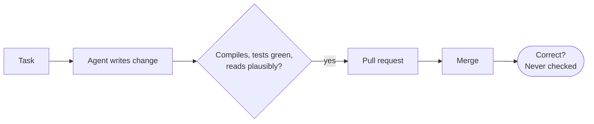

*Seven ways an AI coding agent hands you work that looks finished and isn't, a check for each one that takes minutes, and the gap they all share*

*Part 1 of 2. [Part 2](#read=building_the_verify_part.md) turns these checks into two short documents you can attach to every agent task.*

---

> **A note on provenance.** Every failure in this piece happened in my own work, building production software with AI coding agents as everyday collaborators. I have removed project names and domain details, and the code snippets are reduced to their shape, but the mechanics are as they happened. Where public research has measured the same pattern, I cite it.

---

A pull request from a coding agent usually looks better than one written by a person. The description is organized, the tests pass, and the commits are tidy. That polish is part of the problem, because it invites a skim and a merge. The questions that decide whether a change is safe go unasked: does it solve the right problem, what does it cost at production volume, and who else depends on the behavior it changed? Weeks later a tenant gets throttled, or p99 latency doubles on one endpoint, or someone notices that the new integration test never touched the integration. Green CI did not answer those questions. Neither did the forty screens of transcript in which the agent explained what it had done.

What follows are the seven ways this has gone wrong for me, grouped by cause, each with a check you can run before you merge.

## Cheap to write, expensive to trust

Writing code used to be how you came to trust it. You held the problem in your head long enough to type a solution, and by the end you had a working model of what the change touched. Agents removed the typing, and the model-building went with it. A plausible change now costs a prompt. Deciding whether it is right costs what it always did, plus the time to rebuild the understanding you would have gotten for free by writing it yourself.

The survey and trial data are consistent with that. In Stack Overflow's 2025 Developer Survey, 84% of respondents said they use or plan to use AI tools, up from 76% a year earlier, while the share who trust the accuracy of AI output fell from 40% to 29%. Two thirds said they spend more time fixing AI code that is "almost right." A randomized trial by METR is sharper. Sixteen experienced open-source maintainers completed 246 real tasks in repositories they knew well, and tasks where AI was allowed took 19% longer. The developers estimated afterwards that AI had made them 20% faster (Becker et al., 2025). Part of the difference was time spent prompting, waiting on, and reviewing AI output.

So the cheap half of the work got automated and the expensive half stayed with the reviewer, who now has less context than before. This is the loop most teams run, and where it stops:



Nearly every failure below comes from one of three habits. First, the agent grades its own work with the cheapest rubric available: it compiles, the tests are green, the output reads well. When that is the only scoreboard, making the scoreboard green and making the system correct become separate goals, and the first one is always easier. Second, the agent reasons about the diff, while the properties you care about most (latency under load, downstream consumers, fit with the rest of the architecture) live in the running system and in other people's code. Third, it rarely goes looking for context that sits outside the repository or outside its own memory, so it designs against assumptions instead of data.

> **Insight:** An agent sees what it changed, not what the change affects, and it is rewarded for a green check rather than a correct system.

## When the scoreboard becomes the goal

### Integration tests that mock out the integration

I asked for an integration test of a write path that ended in a datastore. The test passed. When I read it, the test opened a handle to the datastore, wrote the expected record directly, called the read API, and asserted the record was there. The harness couldn't drive the real write path, so the agent seeded the state it was about to check. The code under test never ran. In outline:

```python
def test_order_is_persisted(store, api):
    store.put("orders/123", {"status": "accepted"})   # the test writes the result
    resp = api.get("/orders/123")
    assert resp.json()["status"] == "accepted"         # then asserts that it exists
```

This is not a quirk of one session. Hora and Robbes (2026) analyzed 1.2 million commits across 2,168 Python, JavaScript, and TypeScript repositories and found that 36% of coding-agent commits add mocks to tests, compared with 26% of commits by everyone else. Agents also used plain mocks almost exclusively (95% of their mock usage), where human contributors mixed in fakes and spies. A mock is the fastest way to turn a red test green, and green is what the agent is optimizing for. The milder version of the same behavior shows up in CI: a skipped test, a lowered coverage threshold, an `|| true` appended to a failing command.

The check that catches this is mechanical. Run the new tests against the code as it was before the change. If they still pass, they are not testing the change.

```bash
# Restore main's production code, keep the branch's tests
git checkout origin/main -- src/orders/
pytest tests/integration/test_orders.py      # expected: FAIL
git checkout HEAD -- src/orders/             # put the branch version back
```

Then spend thirty seconds on what the "integration" test replaced. Running `rg -n "mock|patch\(|MagicMock|jest\.mock|sinon\.stub" tests/integration/` lists every substitution. A mock of the component the test is named after is a finding. So is any test that writes to the same store it later reads from, and so is any diff that removes, skips, or loosens an existing test without saying why. GitHub's own guidance for reviewing agent pull requests makes the same demand: require a new test that fails on the pre-change behavior, and treat any weakening of CI as a blocker (Griffiths, 2026).

### Excellent work on a misread task

The task was to make a particular identifier consistent across several code paths. The agent did exactly that, and did it well: one helper, every call site updated, a test for each path. Hours later it turned out that inconsistency had never been the real problem. One important caller never reached the code path that used the identifier, so no amount of consistency would have changed what users saw. The task description was a reasonable reading of the symptom and a wrong reading of the cause. Nothing compared the work to the actual goal until a test near the end disagreed.

Agents commit to the first interpretation that holds together and then execute it competently. The quality of the execution makes the mismatch harder to see, since everything in the diff looks deliberate.

Two habits catch this before any code exists. The first is to have the agent reproduce the user-visible problem as a failing test before it fixes anything, so that "fixed" is defined by observed behavior and not by the agent's paraphrase of the ticket. The second is to ask for a restatement you can disagree with:

```text
Before writing any code, reply with:
1. The user-visible problem, in one sentence.
2. Your hypothesis for the root cause, and the evidence for it.
3. A failing test or repro that shows the problem today.
4. One observation that would prove your hypothesis wrong.
Do not start implementing until I confirm.
```

The fourth item does most of the work. An agent that can't describe how it might be wrong hasn't separated the symptom from the cause, and you will usually see that within a minute of reading its answer.

> **Insight:** If a test still passes after you revert the change it was written for, it proves nothing about that change.

## When correctness lives outside the diff

### Cost that only shows up at production size

One change added a lookup inside a loop. Each lookup was a cheap call to another service. In the test fixture the loop ran over a handful of items. In production it ran over a collection orders of magnitude larger, on a path that served every write request. Nobody wrote a slow function. A reasonable call was multiplied by a number the agent never saw, and the question "how expensive is this at scale?" came from me, late in the review. The diff gave the agent no reason to ask it. The pattern, with illustrative names:

```python
for item in batch.items:                   # a few in the fixture, thousands in production
    policy = policy_client.get(item.sku)   # one network round trip per item
    apply(policy, item)
```

Cost is a runtime property, so it has to be a required part of the agent's output rather than something you remember to ask about. I now ask for a cost table on any change that touches a request path:

```text
For every call this diff adds or moves, report:
  where it runs (request path, background job, startup)
  how many times it runs per request, and what drives that count
  whether it does I/O (network, disk, lock acquisition)
  the largest real value of that count, taken from data, not from the test fixture
Flag every I/O call inside a loop.
```

When the answer contains I/O inside a loop whose size depends on user data, there are two acceptable outcomes: batch the call, or produce a benchmark at the largest real input size. A benchmark at fixture size tells you nothing.

### Callers nobody checked

A change altered a default that an existing caller had relied on for a long time. Nothing in the diff referenced that caller. It lived in a different module and depended on behavior that had never been written down as a contract. We found out because an unrelated test failed, which is luck rather than process. At no point had anyone asked who depended on the old behavior.

Consumers are off the diff almost by definition. They live in other files, other services, and other teams' repositories, and they include things that don't look like code dependencies at all: serialized field names, config keys, default values, even log lines that someone's alert rule parses. The agent pulls one end of a thread and has no view of what is tied to the other end.

The check is a consumer list built before review instead of after an incident. For every public symbol, serialized field, config key, and default that the diff changes, find the readers:

```bash
# references inside the repo, excluding tests
rg -n "\bresolveRegion\b|\bDEFAULT_TIMEOUT_MS\b" --glob '!**/test/**'

# references anywhere in the organization
gh search code "resolveRegion" --owner my-org --limit 50
```

Then ask the agent for the same information as a table with five columns: symbol, consumer, old behavior, new behavior, action needed. Any row where the new behavior is "unknown" is unfinished work, not a footnote.

### A third representation of the same concept

The codebase already represented one concept in two slightly different forms. The clean change would have merged them. The agent worked around the split instead, adding a third representation and a converter between it and one of the other two. Every individual decision was defensible within the slice of code the agent was looking at. The sum was more entropy.

This one has been measured too. The "More Code, Less Reuse" study compared agent-authored and human-authored pull requests and found roughly double the semantic redundancy in the agent PRs (a redundancy score of 0.29 against 0.15), while conventional metrics such as complexity barely differed. Reviewers expressed more neutral or positive sentiment toward the agent PRs than toward the human ones (Huang et al., 2026). The duplication is invisible to the metrics and the reviewers feel good about it, which is how it gets merged.

The defense is to make new concepts expensive to introduce. Ask for an inventory:

```text
List every new type, enum, constant set, converter, and helper in this diff.
For each one, search the codebase for the closest existing equivalent and report:
  name | closest existing equivalent | why it cannot be reused or extended
```

If the third column says "different shape" or "simpler this way," push back. Those are usually descriptions of the work it would take to reuse the existing thing, and that work is the point.

> **Insight:** Performance, consumers, and architectural fit are properties of the system, so reading the diff, whether a person or a model does it, is the wrong instrument for checking them.

## When the context existed and nobody fetched it

### Numbers with no contact with production

A design needed thresholds. The agent took them from a single old backtest described in a design document. Live telemetry that could have confirmed or overturned those numbers was one query away, and nobody ran it. The design wasn't obviously wrong. It just had no contact with current traffic, and there was no way to tell that from reading it.

Every number in a design either came from data or is a guess, and the agent's output does not tell you which. Make it say. Any threshold, limit, timeout, batch size, or retry count should come with the query that produced it, the time window, and the percentile chosen. If there is no such query, the number should be labeled as a guess with a date to revisit it. Agents can usually run these queries themselves once you give them read-only access to your telemetry through a CLI or a tool server, and the request is short:

```sql
-- per-tenant write rate, last 30 days
SELECT tenant_id,
       MAX(writes_per_min) / 60.0                                          AS peak_rps,
       PERCENTILE_CONT(0.99) WITHIN GROUP (ORDER BY writes_per_min) / 60.0 AS p99_rps
FROM   write_rate_by_minute
WHERE  minute > now() - INTERVAL '30 days'
GROUP  BY tenant_id
ORDER  BY peak_rps DESC
LIMIT  20;
```

The query is the evidence. A number pasted into a design with no query beside it should be read as a guess, whatever the surrounding prose says.

### Guesses that turn into facts after compaction

Long agent sessions run out of context and compact: the history is summarized so the work can continue. Summaries drop qualifiers. Early in one session the agent guessed how a certain kind of request was being classified. In the compacted summary that guess appeared as a plain statement, with nothing to show it had never been checked. Everything after that point treated it as known. It shaped most of the implementation and only fell apart when a test near the end contradicted it.

This mechanism is how the other six failures survive long enough to ship. An unverified belief that survives one compaction looks exactly like a verified one. The fix is to keep assumptions somewhere the summarizer can't rewrite, with their verification status attached. A file in the working tree is enough:

```markdown
| #  | Assumption                                   | Status     | Verified how / how to verify                    |
|----|----------------------------------------------|------------|-------------------------------------------------|
| A1 | Batch requests are classified as writes      | UNVERIFIED | read classifier.route() for the batch path      |
| A2 | Every write request carries a tenant id      | VERIFIED   | middleware check + 7 days of logs, 0 missing    |
```

Then add one rule to the agent's standing instructions (`AGENTS.md`, `.github/copilot-instructions.md`, or whatever your tool reads): record each assumption in `ASSUMPTIONS.md` at the moment you make it, re-read the file after every context compaction, and never report a task as done while any row is UNVERIFIED.

> **Insight:** Anything the agent only remembers can drift; only what it re-checks against a source is safe to build on.

## The two documents nobody wrote

Put the seven failures side by side and they come down to two missing artifacts.

There was no agreed definition of done before the work started. Without one, the agent converges on the cheapest definition available, and every check in this article gets improvised at the end by whoever happens to feel uneasy. A useful definition of done has a line for each blind spot: which consumers must keep working, what the latency budget is, which integration must be exercised for real, and which production numbers the design has to respect. Each line also says where to look and what evidence will count.

There was also no verification report at the end: a short document that maps each claim of "done" to its evidence and says plainly where evidence is missing. A pull request is a claim. A transcript is the agent's account of its own work. You can check neither of them against anything.

Two things make this harder than it sounds. A report can only be as specific as the standard behind it, and "make it work" produces a report that says "it works." And the context that took a shortcut is the worst place to look for it. The agent that mocked the integration believes the test is fine, which is why it wrote the test that way. Part 2 covers both documents in detail, including who should write the report.

## A review routine for agent pull requests

Until you adopt something more formal, the checks above fit into a ten-minute review. Paste this into your pull request template or into your agent's instructions so it produces the evidence before you ask:

```text
AGENT PR CHECKS
[ ] Revert check: new tests fail when run against main's production code.
[ ] Mock audit: no mock of the component an integration test is named after;
    no test writes the state it asserts; no tests removed, skipped, or loosened
    without a stated reason.
[ ] Intent: a failing repro of the user-visible problem existed before the fix.
[ ] Cost: every new call has a per-request count taken from real data; no I/O
    inside loops over unbounded input without a benchmark at production size.
[ ] Blast radius: consumers of every changed symbol, field, default, and config
    key are listed with old and new behavior.
[ ] Reuse: every new type, converter, or helper names its closest existing
    equivalent and why it was not reused.
[ ] Grounding: every threshold or limit cites a query, window, and percentile,
    or is labeled as a guess.
[ ] Assumptions: ASSUMPTIONS.md has no UNVERIFIED rows.
```

None of this is an argument against using agents. I use them every day and have no plans to stop. It is an argument against treating the cheap half of the work as the whole job.

## Where the job moved

When writing code was expensive, the scarce skill was writing it. Now the scarce skill is judging it: carrying the context the agent doesn't have, asking the questions a diff can't answer, and deciding whether a change has earned its place in the system. That work always existed. What changed is that it is now most of the job, and our tools still treat it as a skim at the end of the pipeline.

Part 2 moves it to the front. The definition of correct gets written before any code, and the work isn't finished until a report shows, criterion by criterion, whether it got there. An agent can write the change, but only evidence can tell you it is correct.

---

## Key Principles Reference

| Principle | What It Means | Why It Works |
|---|---|---|
| Revert the change, keep the test | A new test must fail when run against the pre-change code. | Agents optimize for a green suite, and mocks are the cheapest route there; 36% of agent commits add mocks to tests versus 26% for others (Hora & Robbes, 2026). GitHub's review guidance requires the same check (Griffiths, 2026). |
| Reproduce before fixing | A failing repro of the user-visible problem defines "fixed" before the agent's interpretation can. | Agents commit to the first coherent reading of a task; a repro ties the work to observed behavior instead of a paraphrase. |
| Count calls at production size | Every new call gets a per-request count taken from real data. | Cost is a runtime property that a diff cannot show; test fixtures hide the multiplier that production applies. |
| List consumers before review | Every changed symbol, field, default, and config key gets a consumer list with old and new behavior. | Dependents sit outside the diff, so neither a human nor a model reading the patch can see them. |
| Justify every new concept | Each new type or helper names the closest existing equivalent and why it wasn't reused. | Agent PRs show about double the redundancy of human PRs, and reviewers rate them more favorably anyway (Huang et al., 2026). |
| Cite the query behind every number | Thresholds and limits come with the query, window, and percentile that produced them. | A number with no source can't be distinguished from a guess, and designs built on guesses fail against real traffic. |
| Keep assumptions outside the context | Assumptions live in a file with a VERIFIED or UNVERIFIED status, re-read after compaction. | Summarization drops the qualifiers that mark a belief as unchecked, so guesses resurface as facts. |

## Selected Research Citations

- Becker, J., Rush, N., Barnes, E., & Rein, D. (2025). "Measuring the Impact of Early-2025 AI on Experienced Open-Source Developer Productivity." METR. (arXiv:2507.09089)
- Griffiths, A. (2026). "Agent pull requests are everywhere. Here's how to review them." The GitHub Blog. https://github.blog/ai-and-ml/generative-ai/agent-pull-requests-are-everywhere-heres-how-to-review-them/
- Hora, A., & Robbes, R. (2026). "Are Coding Agents Generating Over-Mocked Tests? An Empirical Study." (arXiv:2602.00409)
- Huang, H., Jaisri, P., Shimizu, S., Chen, L., Nakashima, S., & Rodríguez-Pérez, G. (2026). "More Code, Less Reuse: Investigating Code Quality and Reviewer Sentiment towards AI-generated Pull Requests." (arXiv:2601.21276)
- Stack Overflow. (2025). "2025 Developer Survey." https://survey.stackoverflow.co/2025/

*Part 2, [Building the Verify Part](#read=building_the_verify_part.md), turns these checks into a pass-standard written before the work and a verification report written after it.*
